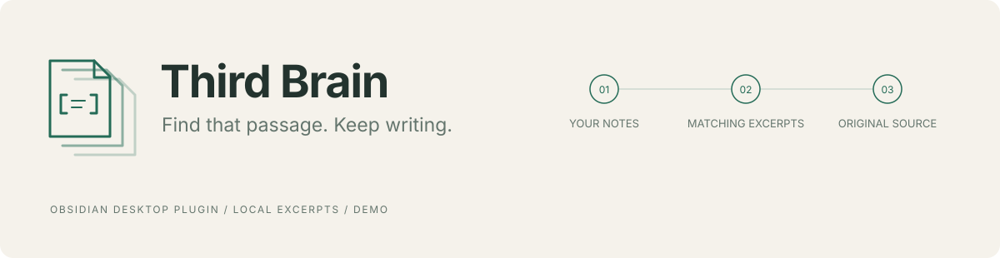
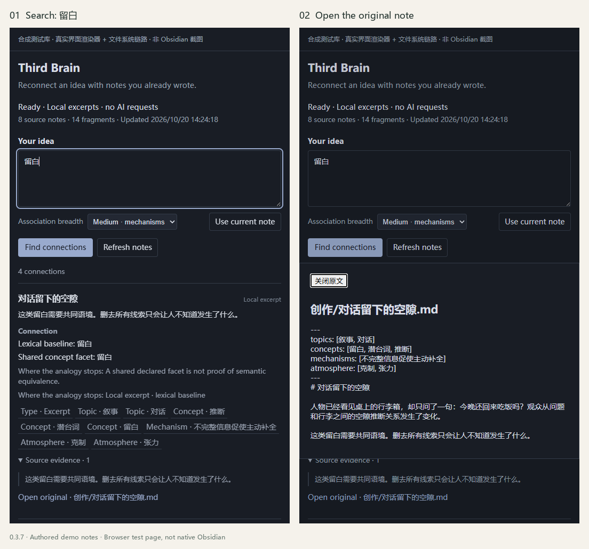
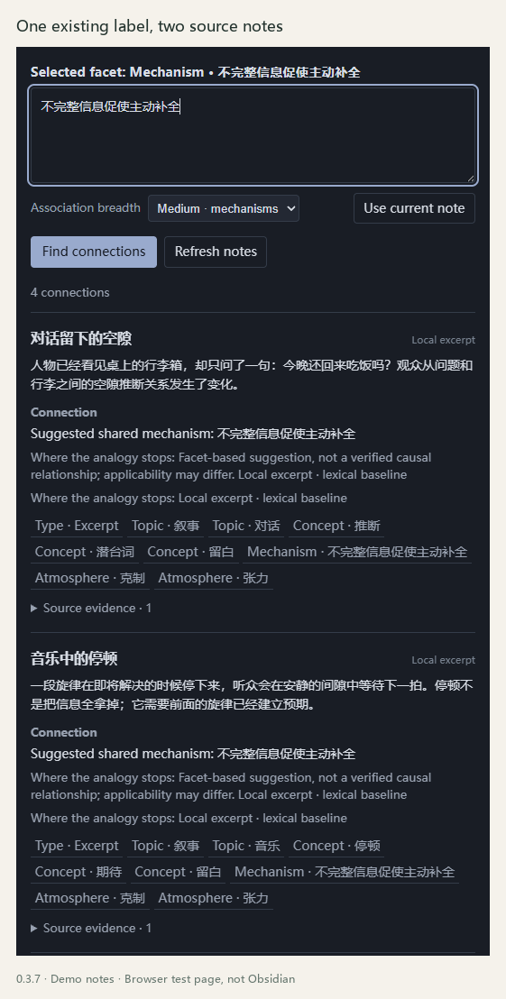

# Third Brain

[简体中文](README.zh-CN.md) · English

Third Brain is a plugin for the **Obsidian desktop note-taking app**. It helps you find passages in your notes. Click **Refresh notes**, type words from an idea, then read matching excerpts and open their original notes. The default mode runs on your computer without an account or API key. You need **desktop Obsidian 1.11.5 or newer**.

**[Download the 0.3.7 demo](https://github.com/Yueyue673/obsidian-third-brain/releases/download/0.3.7/third-brain-0.3.7.zip)** · [Install](#install) · [Try the sample notes](fixtures/sample-vault)

> Desktop demo. Start in a test vault. The download is version 0.3.7; `main` includes newer, unreleased changes. Optional AI features are experimental.

<picture>
  <source media="(prefers-color-scheme: dark)" srcset="docs/images/readme-cover-dark.svg">
  
</picture>

## Find a passage, then check the original

You're writing a dialogue scene and want to revisit your notes about leaving things unsaid. In the [sample notes](fixtures/sample-vault), search for **`留白`** — a Chinese term for leaving space for the reader or listener.

1. Click **Refresh notes**, then search for `留白`.
2. Read the passages returned from the dialogue and music notes, along with their matching reasons.
3. Expand **Source evidence** and click **Open original** to return to the note. The dialogue example includes the warning: leaving out every clue can make the scene incomprehensible.



*Authored demo notes, local mode. Screenshots use the released plugin's renderer in a browser test page, not native Obsidian. The Chinese note text is shown as written; the plugin has not translated it. [Open full-size image](docs/images/showcase-search-en.png).*

Local search matches words and existing note labels. It does not understand every paraphrase, so an unrelated search can return nothing.

## Follow an idea into another note

The sample dialogue and music notes both have the label **`不完整信息促使主动补全`**: incomplete information prompts the audience to fill in the gaps.

Set breadth to **Medium** and click that mechanism label on a result card. The plugin finds passages carrying the same label, so you can compare a pause in music with something left unsaid in dialogue. Here, “mechanism” means a shared process or principle.



*These labels were written into the demo notes in advance. This example does not show AI discovering a connection. [Open full-size image](docs/images/showcase-connection-en.png) · [How the examples were checked](docs/SHOWCASE.md).*

**Low / Medium / High** changes how widely the plugin looks for connections. High can also show separate indirect suggestions with quotations from both notes. A suggested connection may not be useful; compare the sources before reusing it.

## Keep your notes, update the excerpts

- **After editing a note:** click **Refresh notes** again. Unchanged notes reuse their saved results. Old results whose sources changed must be checked again before they can be opened.
- **While writing:** select a passage and click **Use current note**. It fills the idea box; you review it and start the search yourself. Nothing is inserted into your note.
- **When saving results:** the plugin writes separate Markdown files under `Third Brain/Fragments` by default. It does not rewrite your original notes or overwrite manually edited generated files.

Manual refresh is the default. Daily or weekly refresh runs only while Obsidian is open. You can cancel a running task.

## Install

This demo is **not in Obsidian's Community plugins directory** yet. Installation does not need Node.js or an API key.

1. Download [third-brain-0.3.7.zip](https://github.com/Yueyue673/obsidian-third-brain/releases/download/0.3.7/third-brain-0.3.7.zip). Choose the plugin ZIP, not **Source code**. [Check the download](docs/GETTING-STARTED.md#check-the-download).
2. Extract it. Put these four files directly inside your test vault:

   ```text
   .obsidian/plugins/third-brain/
   ├── main.js
   ├── manifest.json
   ├── styles.css
   └── LICENSE
   ```

3. Restart Obsidian. In **Settings → Community plugins**, allow third-party plugins if prompted and enable **Third Brain**. Click the brain icon in the left ribbon.
4. Add a few notes, keep **Local excerpts** selected, and click **Refresh notes**. Enter a word or idea and click **Find connections**.

For the examples above, copy the [sample notes](fixtures/sample-vault) into your test vault first. [Installation help](docs/GETTING-STARTED.md) · [Troubleshooting](docs/TROUBLESHOOTING.md).

## What to expect

- **Desktop only:** requires Obsidian 1.11.5+. Mobile is not supported. Markdown and text nodes in Canvas are supported; PDFs, images and compressed drawings are not indexed as note text.
- **Offline by default:** local-excerpt mode processes notes on your computer and sends no note text to a model service. Your own vault sync or backup software works separately. The plugin does not collect clicks, dwell time or a typing history.
- **AI is optional:** local and cloud model modes require a separately configured model service. Cloud mode also requires your explicit permission; eligible note text and submitted searches may then leave your computer. Notes marked local/private are excluded from cloud requests. Read [model setup](docs/GETTING-STARTED.md#optional-model-setup) and [privacy](docs/PRIVACY.md) first.
- **Results have limits:** searches show a limited set of matches. AI can miss connections or misinterpret text. A correct quotation proves the source, not the explanation. This release's complete native Obsidian click flow, real provider compatibility and broader AI quality still need testing.
- **Generated files are not encrypted:** excerpts and history may enter sync or backups. Removing a source does not erase every old excerpt.

Recent source builds improve context preservation and source navigation, but those changes are **not in the 0.3.7 download**. See the [changelog](CHANGELOG.md), [compatibility notes](docs/COMPATIBILITY.md) and [testing record](docs/VERIFICATION.md) for version-specific details.

## Help, contribute, or build

Found a problem? [Open an issue](https://github.com/Yueyue673/obsidian-third-brain/issues/new) with your Obsidian version, plugin version, what you tried and what happened. Please use a small invented example rather than private notes.

For code or documentation changes, start with [Contributing](CONTRIBUTING.md). [Build from source](docs/GETTING-STARTED.md#build-from-source) requires Node 22.12+ and npm; installing the ZIP does not. `npm run demo` opens the browser test page, not Obsidian or a live AI model.

[Architecture](docs/ARCHITECTURE.md) · [Security](SECURITY.md) · [Third-party notices](THIRD-PARTY-NOTICES.md)

## License

Created by [Yueyue](https://github.com/Yueyue673). [MIT](LICENSE).
