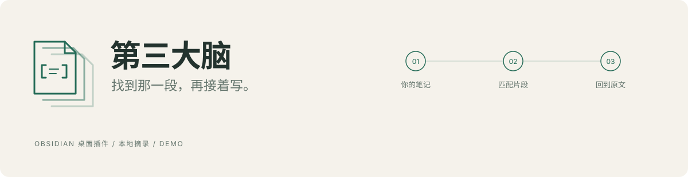
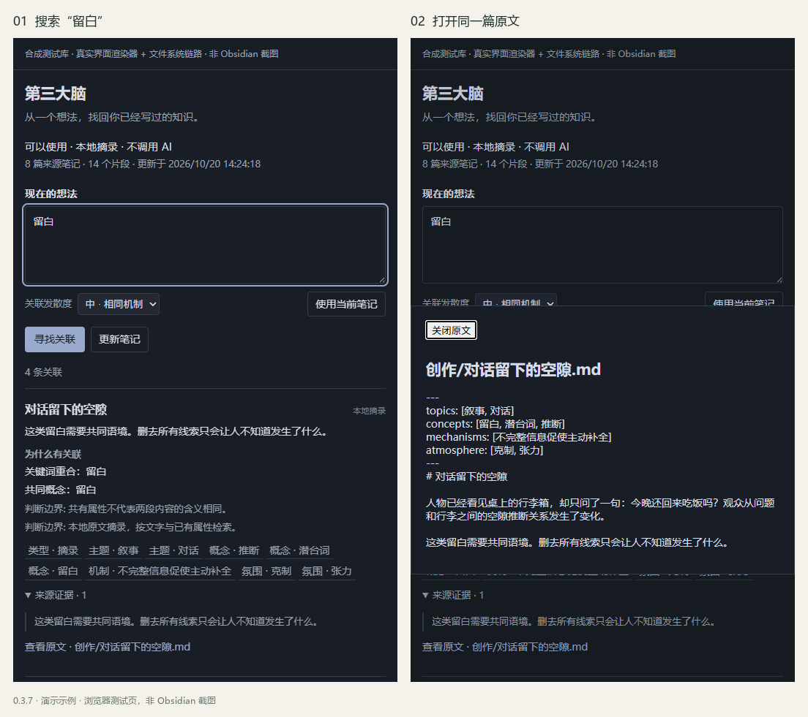
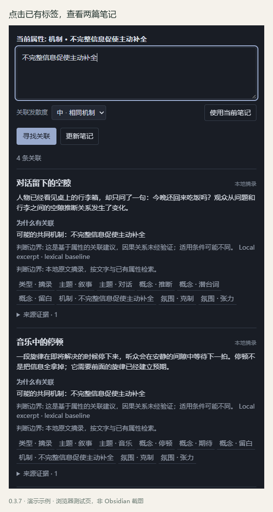

# 第三大脑 · Third Brain

简体中文 · [English](README.md)

第三大脑是 **Obsidian 笔记软件的桌面插件**，帮你从笔记里找回相关段落。点「更新笔记」，输入一个词或想法，就能查看匹配片段、匹配理由，再打开原笔记。默认在你的电脑上处理，不需要账户或 API 密钥。使用前需要安装 **Obsidian 1.11.5 或更新的桌面版本**。

**[下载 0.3.7 Demo](https://github.com/Yueyue673/obsidian-third-brain/releases/download/0.3.7/third-brain-0.3.7.zip)** · [安装方法](#安装) · [示例笔记](fixtures/sample-vault)

> 当前是桌面端 Demo，建议先在测试库中试用。下载包为 0.3.7；`main` 分支包含尚未发布的改进。可选的 AI 功能仍在实验阶段。

<picture>
  <source media="(prefers-color-scheme: dark)" srcset="docs/images/readme-cover-zh-dark.svg">
  
</picture>

## 找到那一段，再接着写

你正在写一段对话，想回看以前记过的「留白」。把[示例笔记](fixtures/sample-vault)放进测试库后：

1. 点「更新笔记」，再搜索 **`留白`**。
2. 查看对话和音乐笔记里的相关段落，以及它们为什么被找到。
3. 展开「来源证据」，点「查看原文」，回到原笔记。对话笔记还写着一个限制：删去所有线索，只会让人不知道发生了什么。



*演示示例，使用本地模式。截图来自已发布版本的真实界面渲染器和浏览器测试页，不是原生 Obsidian 截图。[查看大图](docs/images/showcase-search-zh.png)。*

本地搜索按文字和笔记已有标签匹配，不保证理解换一种说法的输入。没有相关内容时，可以不返回结果。

## 从一个共同做法，找到另一篇笔记

示例中的对话笔记和音乐笔记，都写有 **`不完整信息促使主动补全`** 这个标签。

把发散度设为「中」，再点结果卡片上的这个「机制」标签，就能找到带相同标签的段落，对比音乐中的停顿和对话里的潜台词。这里的“机制”，指共同的做法或原理。



*标签提前写在演示笔记中，这个案例不代表 AI 自动发现了联系。[查看大图](docs/images/showcase-connection-zh.png) · [案例核验说明](docs/SHOWCASE.md)。*

「低／中／高」控制查找范围。高发散还可能单独列出间接建议，并给出两篇笔记的引用。建议不一定适合当前问题，复用前请对照原文判断。

## 原笔记照常写，片段另外保存

- **修改笔记后：**再点「更新笔记」。没改动的笔记复用已有结果；来源改变后的旧结果，需要重新核对才能打开。
- **写到一半想找参考：**选中文字，点「使用当前笔记」，内容会填入想法框。你检查后再搜索，插件不会把文字插入原笔记。
- **保存整理结果时：**默认另存为 `Third Brain/Fragments` 下的 Markdown 文件，不重写原笔记，也不覆盖人工改过的生成文件。

默认手动更新。也可以设为每日或每周更新，只在 Obsidian 打开时运行；任务执行中可以取消。

## 安装

目前**尚未上架 Obsidian 社区插件目录**。安装发布包不需要 Node.js 或 API 密钥。

1. 下载 [third-brain-0.3.7.zip](https://github.com/Yueyue673/obsidian-third-brain/releases/download/0.3.7/third-brain-0.3.7.zip)。选插件 ZIP，不要选 **Source code** 源码包。[下载校验方法](docs/GETTING-STARTED.md#中文上手)。
2. 解压，把以下四个文件直接放进测试笔记库的这个位置，不要多套一层文件夹：

   ```text
   .obsidian/plugins/third-brain/
   ├── main.js
   ├── manifest.json
   ├── styles.css
   └── LICENSE
   ```

3. 重启 Obsidian，在「设置 → 第三方插件」中按提示允许第三方插件，启用 **Third Brain**，再点左侧脑形图标。
4. 加入几篇笔记，保持「本地摘录」模式，点「更新笔记」。输入一个词或想法，再点「寻找关联」。

复现上面的案例前，先复制[示例笔记](fixtures/sample-vault)到测试库。[详细上手](docs/GETTING-STARTED.md#中文上手) · [常见问题](docs/TROUBLESHOOTING.md#中文)。

## 使用条件与限制

- **仅桌面端：**需要 Obsidian 1.11.5 或更新版本，不支持手机和平板。支持 Markdown 和 Canvas 中的文字节点；不把 PDF、图片或压缩绘图当作笔记正文处理。
- **默认离线：**「本地摘录」在电脑上处理，不把笔记正文发送给模型服务。你自己的笔记库同步、备份软件另算。插件不收集点击、停留或输入历史。
- **AI 需要另行配置：**本机模型、云端模型都需要自备模型服务。云端模式还需明确开启，之后允许处理的笔记正文和搜索输入可能发送给服务商；标为 local/private 的笔记不发往云端。请先读[模型配置](docs/GETTING-STARTED.md#配置模型)和[隐私说明](docs/PRIVACY.md#中文)。
- **结果不保证齐全或正确：**搜索只显示有限条结果。AI 可能漏掉联系、误解内容；引用真实，只能证明出处，不能证明解释正确。本版的完整原生 Obsidian 点击流程、真实服务商兼容性和更大范围的 AI 效果仍待验证。
- **生成文件没有加密：**摘录和历史可能进入同步或备份。移除原笔记，不等于清除所有旧摘录。

最新源码已改进语境保留和原文定位，但**这些改动不在 0.3.7 下载包里**。不同版本的范围见[更新记录](CHANGELOG.md)、[兼容性](docs/COMPATIBILITY.md)和[测试记录](docs/VERIFICATION.md)。

## 反馈、贡献与开发

遇到问题时，可以[提交 Issue](https://github.com/Yueyue673/obsidian-third-brain/issues/new)，说明 Obsidian 版本、插件版本、做了什么、出现了什么。请用自己编写的小例子复现，不要贴私人笔记。

修改代码或文档前请看[贡献指南](CONTRIBUTING.md)。只有[源码构建](docs/GETTING-STARTED.md#build-from-source)需要 Node 22.12+ 和 npm，直接安装 ZIP 不需要。`npm run demo` 是浏览器测试页面，不是 Obsidian，也不调用真实 AI 模型。

[架构](docs/ARCHITECTURE.md) · [安全](SECURITY.md) · [第三方声明](THIRD-PARTY-NOTICES.md) · [封面与独立海报](docs/posters/README.md)

## 许可证

作者：[Yueyue](https://github.com/Yueyue673)。使用 [MIT 许可证](LICENSE)。
