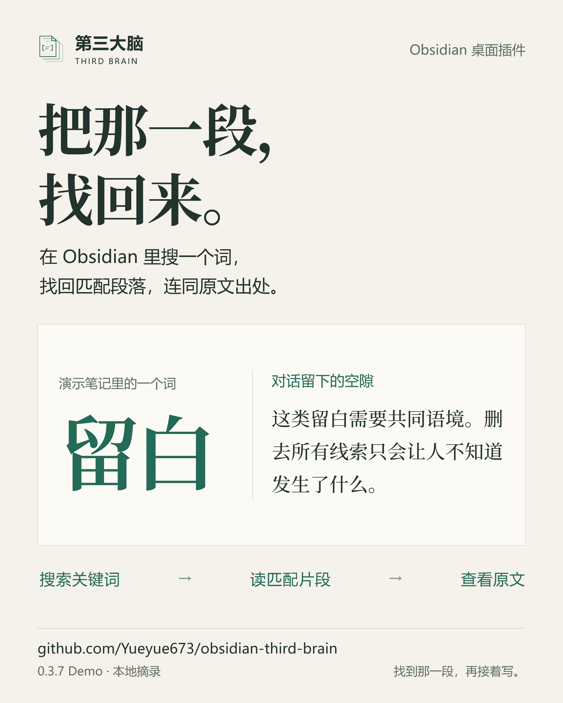
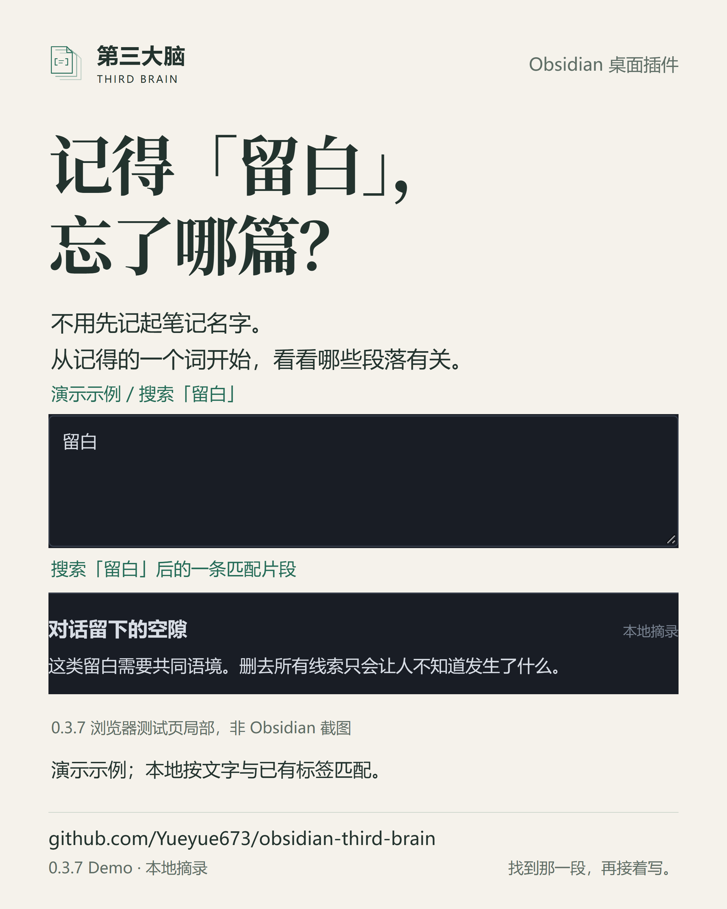
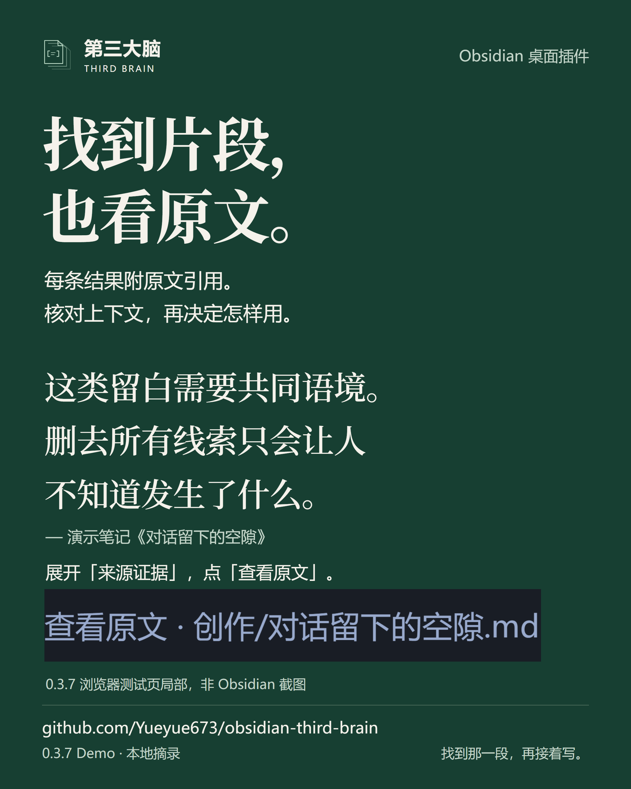
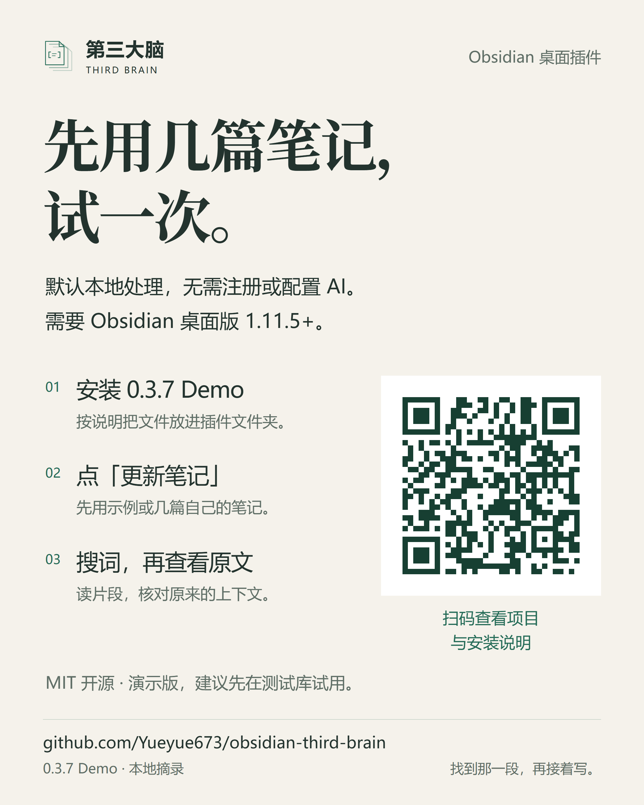

# 找到那一段，再接着写。

[项目介绍](../../README.zh-CN.md) · [安装与第一次使用](../GETTING-STARTED.md#中文上手) · [English](#english)

第三大脑是 Obsidian 桌面插件。输入一个词，查看笔记中匹配的段落，再打开原笔记核对上下文。这组海报围绕这个已实现的动作展开，不宣传自动写作或未经验证的 AI 理解能力。

四张均为 **2160 × 2700 PNG，4:5 竖版**，可以分别保存和发布。README 使用另行设计的横版封面和真实案例图，不重复插入整套海报。

## 1. 先让人知道用途

**把那一段，找回来。** 用演示笔记中的「留白」和一段准确原文，呈现关键词 → 片段 → 原文的使用过程。排版引文是概念视觉，不是产品界面。

[下载原图](01-find-the-passage.png)



## 2. 认出具体场景

**记得「留白」，忘了哪篇？** 展示真实输入区域和实际返回的一条笔记片段，不要求先记起笔记名字。

[下载原图](02-remember-the-word.png)



## 3. 解释怎样核对出处

**找到片段，也看原文。** 放大完整引用和真实「查看原文」入口，让人理解找到一段之后还能做什么。

[下载原图](03-check-the-source.png)



## 4. 给出开始方式

**先用几篇笔记，试一次。** 说明安装演示版、更新笔记、搜索并核对原文的步骤，以及 Obsidian 桌面版 1.11.5+ 的条件。

[下载原图](04-try-the-demo.png)



## 内容依据与边界

- 宣传对应可下载的 [0.3.7 Demo](https://github.com/Yueyue673/obsidian-third-brain/releases/tag/0.3.7)，不把 `main` 的未发布改进写成下载版能力。
- 搜索、返回片段、展开来源证据和查看原文已在 0.3.7 的真实浏览器测试页实际操作。它连接项目的文件读取、控制器和生成文件存储，**不是原生 Obsidian 截图**；测试页里的原文以对话框打开。原生宿主完整点击验收仍待补。
- 材料来自[仓库演示笔记](../../fixtures/sample-vault)，不是私人笔记。已有标签提前写入，不代表 AI 自动发现关联。核验过程见[案例说明](../SHOWCASE.md)。
- 本地模式按文字和已有标签匹配，不保证理解所有换一种说法的输入。“默认本地”只描述默认模式；可选云端模式的数据去向见[隐私说明](../PRIVACY.md#中文)。
- 二维码指向 `https://github.com/Yueyue673/obsidian-third-brain`，已从完整海报和 360 × 450 缩图解码核对。入口地址同时以文字印在每张海报上。

## 可编辑来源与导出

- `posters.html`：四张独立画布及精确文字。
- `posters.css`：纸白、墨绿、中文衬线标题和无衬线说明文字。
- `assets/`：真实界面局部、出处对照图、二维码；不包含私人资料。
- `render.py`：本地导出 PNG，检查尺寸、标题、图片加载、元素越界/重叠和二维码。
- `provenance.json`：发布版、素材来源与检查范围。
- [`../images/readme-cover*.svg`](../SHOWCASE.md#screenshot-and-artwork-notes)：中英、深浅色横版封面，源文件本身可编辑。

当前制作环境没有可调用的图片生成模型。这套素材使用原创矢量图、真实截图与 HTML/CSS 排版完成，**未使用或冒称模型生成画面**。概念画面和实际界面的分工保持明确。

维护者可安装 Python 导出依赖：

```sh
python -m pip install playwright Pillow opencv-python
python -m playwright install chromium
python docs/posters/render.py --font /path/to/NotoSerifSC-VF.ttf
```

也可以用 `--browser /path/to/chrome` 指定现有 Chromium 浏览器，用 `--output /path/to/output` 指定导出目录。需要已安装的 Noto Serif SC 标题字体；未指定 `--font` 时使用 CSS 中的本地字体与回退，外观可能有差异。字体文件不随仓库分发。无需重新运行项目或调用模型即可导出。

原创项目图形和排版沿用 [MIT](../../LICENSE)，署名 Yueyue；字体权利不包含在该许可中。参考 [Voyager](https://github.com/voyager-crew/voyager) 的安装入口、案例优先和图片留白，不复制其品牌、文案或素材。

## English

Four standalone Chinese campaign posters, **2160 × 2700 PNG, 4:5**, with editable HTML/CSS and a local exporter. The campaign is **Find that passage. Keep writing.** Each poster has a different job: explain the product, recognize a search situation, inspect the source, and start a small trial.

Claims and screenshots are tied to the **0.3.7 desktop demo**, not newer source-only features. UI crops use the released renderer in the real browser test page, not native Obsidian. The sample notes have authored labels; the artwork does not claim live AI discovery. The QR points to the repository and was decoded from both the full-resolution poster and a 360 × 450 thumbnail.

Artwork uses original vector graphics, actual screenshots and exact HTML/CSS typography. **No image-generation model was available or used.** Fonts are not bundled. Run the commands above to export locally; `--font`, `--browser` and `--output` accept local paths. See [example provenance](../SHOWCASE.md), [installation](../GETTING-STARTED.md) and [privacy](../PRIVACY.md).
